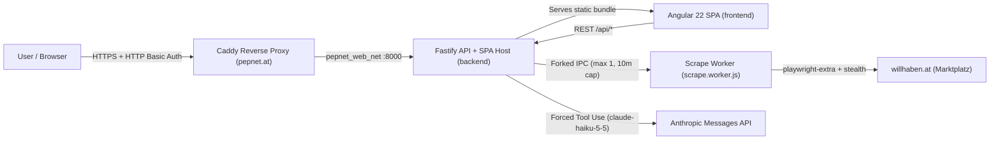

# Architecture

## Project Structure

- `backend/`: Node `26.13.0` + TypeScript `~6.0` Fastify application serving `/api/*` REST endpoints, static SPA assets (`/app/static`), the forked scrape worker (`src/workers/scrape.worker.ts`), the Anthropic Claude Haiku 5.5 listing analyzer (`src/services/analyzer.service.ts`), the live container smoke test (`src/smoke.ts`), and the Vitest unit test suite (`tests/`).
- `frontend/`: Angular `22.2` standalone single-page application (`ChangeDetectionStrategy.OnPush`, Signals, Tailwind CSS v4) following the *Alpine Telemetry Lab* design system (`frontend/DESIGN.md`).
- `contracts/fixtures/`: Shared canonical JSON payloads (`meta.json`, `scrape-job-running.json`, `scrape-job-succeeded.marketplace.json`, `analyze-response.json`, `cli-export.marketplace.json`) validated against backend `zod` schemas and consumed by frontend unit specs.
- `deploy/`: Production Caddy reverse-proxy configuration snippet (`Caddyfile.willhaben.snippet`) for `pepnet.at`.
- `docs/`: Repository workflow guides (`docs/agents/`) and architecture decision records (`docs/adr/`).
- `.github/`: GitHub Actions CI (`ci.yml`), Release CD (`cd.yml`), issue templates, pull request template, and release template.
- `.agents/` & `.claude/`: Local agent skill definitions (`angular-developer`, `frontend-design`) and lockfile (`skills-lock.json`).

## High-Level System Diagram

## Core Components

- **Backend API & SPA Host (`backend/src/app.ts`)**: Fastify v5 server on port `8000` serving `/api/healthz`, `/api/meta`, `/api/status`, `/api/scrape`, `/api/scrape/:jobId`, `/api/analyze`, and static Angular assets from `STATIC_DIR` (`/app/static`). Unknown `/api/*` routes return JSON `404`; non-`/api` `GET` requests fall back to `index.html`.
- **Mode Registry & Marketplace Adapter (`backend/src/modes/`)**: Registers `{ schema, toLibraryOptions, createScraper }` per mode. Version `0.1.0` exposes `'marketplace'` backed by `WillhabenHunterMarketplaceScraper` while keeping the registry extensible for future modes.
- **Isolated Scrape Worker & Single-Flight Lock (`backend/src/services/scraper.service.ts`, `backend/src/workers/scrape.worker.ts`)**: Forks a detached child process per scrape job and communicates over Node IPC (`progress`, `result`, `error`). Enforces a strict single-flight lock (released only upon worker process `exit`) and a 10-minute (`SCRAPE_TIMEOUT_MS = 600000`) hard timeout that kills the entire worker process group (`process.kill(-child.pid, 'SIGKILL')`), including spawned Chromium children.
- **In-Memory Job Store (`backend/src/services/job-store.ts`)**: Retains the currently running job plus the most recent finished job for `SCRAPE_RESULT_TTL_MS` (default `1800000 ms` = 30 minutes) so long scrapes survive browser tab reloads or dropped connections.
- **Claude Haiku 5.5 Listing Analyzer (`backend/src/services/analyzer.service.ts`, `backend/src/services/analysis-input.ts`)**: Truncates per-item `description` and `attributes` to `1,500` characters, enforces a whole-request budget (`ANALYZE_MAX_INPUT_CHARS = 200000`), calls `@anthropic-ai/sdk` (`claude-haiku-5-5`) with forced tool choice (`record_willhaben_analysis`, `max_tokens: 4096`), and joins `title`, `price`, and `url` server-side from the input items by `id`.
- **Angular 22 Workbench (`frontend/src/app/`)**: Standalone `OnPush` SPA providing a Marktplatz filter form driven by `/api/meta`, asynchronous job progress polling (`1.5 s`), `409` running-job re-attachment, CLI JSON file/paste import, RFC 4180 formula-safe CSV & JSON export, KPI telemetry strip, Claude Haiku 5.5 prompt workbench, and filterable results ledger table.

## Architectural Invariants

1. **Single-Container Same-Origin Serving**: Fastify serves both `/api/*` and the compiled Angular bundle on port `8000` (`127.0.0.1:8001->8000` on `pepnet-server`). No `@fastify/cors` is enabled.
2. **Single-Flight Chromium Concurrency**: At most one worker child process may run at any time. The lock is released strictly inside the child process `exit` listener, never earlier on timeout, guaranteeing two Chromium instances cannot overlap on the `3.7 GiB` VPS.
3. **Process-Group Termination on Timeout & Shutdown**: Because `willhaben-hunter` has no `AbortSignal` support, workers are spawned with `detached: true` and terminated via `process.kill(-child.pid, 'SIGKILL')` on timeout (`600000 ms`) or Fastify `onClose` (`SIGTERM`). Container `init: true` reaps any orphaned processes.
4. **Single Source of Truth for Enums (`/api/meta`)**: The Angular bundle never imports `willhaben-hunter` (which pulls in Node/Playwright dependencies). All selectable Bundesländer (`WillhabenHunterArea`), Vienna districts (`1–23`), sort orders (`WillhabenHunterSortOrder`), and limit bounds (`100` with details, `250` with `skipDetails`) are served by `GET /api/meta` and validated against `contracts/fixtures/meta.json`.
5. **Untrusted Listing Text & Server-Side Join**: Listing text (`title`, `description`, `attributes`) is treated as untrusted input in the Anthropic system prompt. The LLM tool output only references item `id`s; the backend drops unknown or duplicate `id`s, clamps `fitScore` to `0..100`, renumbers `rank` `1..n`, and copies `title`, `price`, and `url` exclusively from the validated input item.
6. **Willhaben-Only Link Rendering & Formula-Safe CSV**: Both the JSON importer and the Angular `SafeWillhabenUrlPipe` permit only `https://www.willhaben.at/...` URLs. CSV exports prefix cells starting with `=`, `+`, `-`, `@`, `\t`, or `\r` with `'` to prevent spreadsheet formula injection.
7. **Stateless v1 Operation**: No SQLite database is used in `v0.1.0`. The `/opt/pepnet/willhaben-hunter-web/data/` directory on `pepnet-server` remains an empty git-ignored directory so `openclaw`'s read-only mount (`/opt/pepnet/willhaben-hunter-web/data:/mnt/willhaben:ro`) continues to work without changes.

## API Endpoints

| Method & Path | Status Codes | Description |
| :--- | :--- | :--- |
| `GET /api/healthz` | `200` | Liveness check returning `{ status: 'ok' }`. |
| `GET /api/meta` | `200` | Returns Marktplatz option metadata (Bundesländer, Vienna districts `1–23`, sort orders, limit caps). |
| `GET /api/status` | `200` | Returns `{ scraping, currentJobId, currentMode, currentProgress, startedAt, anthropicConfigured, model }`. |
| `POST /api/scrape` | `202`, `400`, `409` | Validates Marktplatz options, starts a background worker job (`202 { jobId, status: 'running', searchUrl }`), or returns `409 { error: 'scrape_in_progress', message, jobId }` with the active `jobId`. |
| `GET /api/scrape/:jobId` | `200`, `404` | Returns current job state (`running`, `succeeded`, `failed`, `timed_out`), progress string, and completed `result` or `error`. |
| `POST /api/analyze` | `200`, `400`, `413`, `502`, `503` | Evaluates `1..250` items (`bodyLimit: 10 MiB`) against a user prompt via `claude-haiku-5-5` forced tool use and returns ranked recommendations with server-joined item metadata. |

## Container Memory & Runtime Profile (`willhaben-web`)

- **Base Image**: `node:26-bookworm-slim` with `PLAYWRIGHT_BROWSERS_PATH=/ms-playwright` and `npx playwright install --with-deps --only-shell chromium` installed after `npm ci --omit=dev` in `backend/`.
- **Runtime User**: Unprivileged user `willhaben` (`10001:10001`).
- **Docker Compose Limits**: `mem_limit: 1024m`, `shm_size: 256m`, `init: true`.
- **Measured Memory Profile (Local Container Verification)**:
  - Idle Fastify container RSS: `82.51 MiB`.
  - Smoke scrape (`limit: 3`, `skipDetails: true`): completed in `4.8 s`.
  - Detailed Marktplatz scrape (`limit: 25`, `skipDetails: false`, 5 concurrent detail pages): `799 MiB` peak sampled over `27.2 s` (`< 900 MiB` acceptance threshold, within the `1024m` container limit).

## Data Stores

- **In-Memory Job Store (`backend/src/services/job-store.ts`)**: Owned by `backend`; retains the active scrape job plus the most recent finished job in process memory for `SCRAPE_RESULT_TTL_MS` (`1800000 ms`) with no disk persistence.
- **Browser `localStorage` (`frontend/src/app/core/session/local-session.storage.ts`)**: Owned by `frontend`; persists search parameters, prompt, active `jobId`, and loaded items under `willhaben_hunter_session_v1` (falling back to omitting `items` on `QuotaExceededError`).
- **Host `data/` Mount (`/opt/pepnet/willhaben-hunter-web/data/`)**: Empty git-ignored directory on `pepnet-server` preserved exclusively so `openclaw`'s read-only bind mount continues to resolve.

## External Integrations

- **Willhaben Marktplatz (`willhaben.at`)**: Owned by `backend` (`WillhabenHunterMarketplaceScraper` inside `scrape.worker.ts` using Playwright Chromium Headless Shell).
- **Anthropic Messages API (`@anthropic-ai/sdk`)**: Owned by `backend` (`AnalyzerService` using `ANTHROPIC_API_KEY` and `ANTHROPIC_MODEL`, defaulting to `claude-haiku-5-5`).

## Security Considerations

- **Reverse-Proxy Authentication**: Caddy terminates TLS and HTTP Basic Auth (`willhaben.pepnet.at`) before forwarding traffic to `willhaben-web:8000`; the application container binds strictly to `127.0.0.1:8001` on `pepnet-server`.
- **Untrusted Listing Data & Link Safety**: Listing text is marked untrusted in the Anthropic system prompt; `AnalyzerService` joins `title`, `price`, and `url` server-side from input items by `id`, and both `json-import.ts` and `SafeWillhabenUrlPipe` permit only `https://www.willhaben.at/` URLs.
- **Spreadsheet Formula Protection**: `serializeItemsToCsv` prefixes cells beginning with `=`, `+`, `-`, `@`, `\t`, or `\r` with `'`.

## Domain Language

**Marktplatz Scrape Job** (`ScrapeJob`): An asynchronous, single-flight execution of `WillhabenHunterMarketplaceScraper` inside a forked worker process identified by a UUID `jobId`, progressing from `running` to `succeeded`, `failed`, or `timed_out`. _Avoid_: sync run, cron task, browser session.

**Mode Adapter** (`ScrapeModeAdapter`): A backend strategy object (`{ mode, schema, toLibraryOptions, createScraper }`) that decouples HTTP/worker orchestration from a specific `willhaben-hunter` scraper class. _Avoid_: plugin, controller, scraper factory.

**Analysis Budget** (`ANALYZE_MAX_INPUT_CHARS`): The maximum character length (`200,000` chars default) allowed for the serialized, per-field-truncated (`1,500` chars) listing array sent to `POST /api/analyze` before rejecting with HTTP `413 analysis_budget_exceeded`. _Avoid_: token window, context truncation, batch slice.

**Server-Joined Recommendation** (`AnalyzeRecommendation`): A ranked listing evaluation (`top-pick`, `good-alternative`, or `caution` with `fitScore` `0–100`) where qualitative fields come from Claude Haiku 5.5 tool output while `title`, `price`, and `url` are joined on the server from the input item matching `id`. _Avoid_: raw LLM link, hallucinated listing, unverified recommendation.
